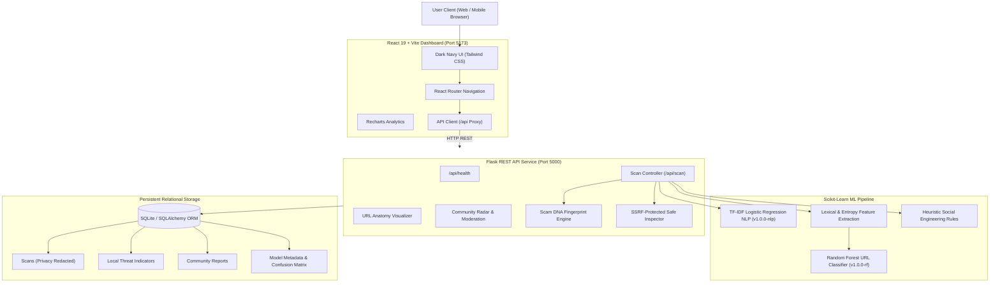

# CyberShield AI — AI-Powered Scam, Phishing & Cyber Threat Detection Platform

> **KALAM INNOVISTA 2K26 Model Innovation Challenge**  
> **Domain:** AI & Emerging Technologies  
> **Project Name:** CyberShield AI  

CyberShield AI is a full-stack, autonomous, explainable cybersecurity platform built to identify deceptive phishing websites, credential harvesting domains, financial fraud SMS, and social engineering scams in real-time.

---

## 🛡️ Key Innovation Highlights

1. **Dual Machine Learning Engine**:
   - **URL Classifier**: Random Forest Classifier trained on lexical, structural, and Shannon entropy features (**96.0% Test Accuracy, 100% Precision, 95.65% F1-Score**).
   - **NLP Message & SMS Classifier**: TF-IDF Vectorizer + Logistic Regression with class-balanced weighting (**100% Test Accuracy on held-out test data**).
2. **Transparent Explainable AI (XAI)**:
   - "Why was this flagged?" breakdown providing rule IDs, exact triggering components (Hostname, Subdomain, Path, Port, Query), concrete evidence, and severity points.
3. **URL Anatomy Decomposition**:
   - Deep structural parser using the **Public Suffix List** (`tldextract`) separating Scheme, Subdomain, Registered Domain, Port, Path, and Query parameters.
   - Highlights deceptive tactics (e.g., brand names embedded into subdomains or paths).
4. **Scam DNA Fingerprinting**:
   - Privacy-conscious canonical structural hashing generating 64-character SHA-256 fingerprints to discover coordinated phishing campaigns and template reuse.
5. **Robust SSRF Protection**:
   - Safe server-side network and SSL inspector strictly blocking private (RFC 1918), loopback, link-local, and cloud metadata (`169.254.169.254`) ranges.
6. **Community Threat Radar**:
   - Crowdsourced threat submission portal with automated duplicate hash detection and human-in-the-loop consensus moderation.
7. **Personal Cyber Safety Coach**:
   - Emergency panic protocol, Indian financial fraud helpline (**Dial 1930** / **cybercrime.gov.in**), and an interactive cybersecurity quiz.

---

## 🏛️ System Architecture



---

## 💻 Technology Stack

| Layer | Technologies Used |
|---|---|
| **Frontend** | React 19, Vite, Tailwind CSS v4, React Router v7, Recharts, Lucide Icons |
| **Backend API** | Python 3.11, Flask 3.0, Flask-CORS, Werkzeug |
| **Database** | SQLite, SQLAlchemy 2.0 ORM, Flask-SQLAlchemy |
| **Machine Learning** | Scikit-Learn 1.4, NumPy, Joblib, TF-IDF Vectorizer, Random Forest |
| **Parsing & Security** | `tldextract` (Public Suffix List), `ipaddress` (SSRF Filter), `hashlib` |
| **Testing** | Pytest 8.2 |

---

## 📁 Repository Structure

```
AI-prototype/
├── backend/
│   ├── app.py                     # Flask application factory and error handlers
│   ├── config.py                  # Environment settings & security configurations
│   ├── database.py                # SQLAlchemy DB initialization
│   ├── models.py                  # Relational models: Scan, ThreatIndicator, CommunityReport, Feedback, ModelMetadata
│   ├── seed_data.py               # Database initialization & baseline seed script
│   ├── requirements.txt           # Python backend dependencies
│   ├── ml/
│   │   ├── feature_extraction.py  # Lexical, structural, & Shannon entropy features
│   │   ├── model_manager.py       # Thread-safe model loader singleton
│   │   ├── train_models.py        # ML training and evaluation script
│   │   └── models/                # Serialized Joblib models (*.joblib)
│   ├── routes/
│   │   ├── scan_routes.py         # /api/scan/url, /api/scan/message, /api/scans
│   │   ├── threat_routes.py       # /api/threats, /api/threats/summary
│   │   ├── report_routes.py       # /api/reports, /api/reports/<id>/review
│   │   ├── anatomy_routes.py      # /api/url/anatomy, /api/url/inspect-safe
│   │   └── dashboard_routes.py    # /api/dashboard/summary, /api/dashboard/trends, /api/model/info
│   ├── services/
│   │   ├── url_detector.py        # Hybrid URL threat engine (ML + Rules)
│   │   ├── message_detector.py    # Hybrid Scam message engine (NLP + Heuristics)
│   │   ├── url_anatomy.py         # URL component decomposition service
│   │   ├── fingerprint_service.py # Scam DNA structural hashing & similarity
│   │   ├── threat_intel.py        # Local & external threat intelligence adapters
│   │   └── safe_inspector.py      # SSRF-protected safe network inspector
│   └── tests/
│       └── test_api.py            # Automated pytest test suite (10/10 passing)
├── frontend/
│   ├── index.html                 # Single page application root
│   ├── package.json               # Frontend dependencies & scripts
│   ├── vite.config.js             # Vite configuration with /api reverse proxy
│   └── src/
│       ├── App.jsx                # Root router & layout
│       ├── main.jsx               # React entry with HashRouter
│       ├── index.css              # Cyber theme & Tailwind CSS v4 styling
│       ├── services/api.js        # REST API integration client
│       ├── components/            # Reusable UI components (RiskBadge, RiskGauge, ExplainabilityCard, ExportReportModal)
│       └── pages/                 # 9 Complete Dashboard Pages
├── start_all.bat                  # One-click full-stack launcher (Windows)
├── start_backend.bat              # Backend launcher script
├── start_frontend.bat             # Frontend launcher script
├── run_tests.bat                  # Automated test runner script
└── README.md                      # Comprehensive project documentation
```

---

## ⚡ Quick Start & Installation

### Prerequisites
- **Python**: 3.11+
- **Node.js**: 20+ and **npm**: 10+

### Option A: One-Click Launch (Windows)
Double-click `start_all.bat` or run:
```powershell
.\start_all.bat
```
This automatically launches the Flask backend on `http://127.0.0.1:5000` and the Vite frontend on `http://127.0.0.1:5173`.

---

### Option B: Manual Setup

#### 1. Backend Setup
```powershell
cd backend

# Create and activate virtual environment
python -m venv venv
.\venv\Scripts\activate

# Install dependencies
pip install -r requirements.txt

# Train machine learning models
python ml/train_models.py

# Seed database with baseline intelligence & sample data
python seed_data.py

# Launch Flask backend
python app.py
```
*Backend runs on `http://127.0.0.1:5000`*

#### 2. Frontend Setup
```powershell
cd frontend

# Install node packages
npm install

# Start Vite development server
npm run dev
```
*Frontend runs on `http://127.0.0.1:5173`*

---

## 🧪 Running Automated Tests

Run the comprehensive pytest test suite verifying URL scanning, NLP detection, SSRF protection, database ORM, and moderation APIs:
```powershell
.\run_tests.bat
```
Or manually:
```powershell
$env:PYTHONPATH="c:\Users\Administrator\Desktop\AI-prototype"
& ".\backend\venv\Scripts\pytest.exe" "backend\tests\test_api.py" -v
```

**Test Suite Coverage (10/10 Passing):**
- `test_health_check`: Verifies service status and DB connectivity
- `test_scan_legitimate_url`: Validates low risk scoring for benign URLs
- `test_scan_phishing_url`: Validates critical threat detection on IP/brand spoofing
- `test_scan_message_scam`: Validates OTP theft detection and phrase highlighting
- `test_scan_message_legitimate`: Validates benign scoring on conversational SMS
- `test_url_anatomy`: Validates Public Suffix parsing and component extraction
- `test_ssrf_safe_inspector_blocks_private_ip`: Verifies SSRF filter blocks loopback
- `test_ssrf_safe_inspector_blocks_metadata_ip`: Verifies SSRF filter blocks 169.254.169.254
- `test_community_report_submission_and_review`: Verifies deduplication and moderation
- `test_model_info_endpoint`: Validates verifiable model accuracy metrics

---

## 🌐 API Reference

| Method | Endpoint | Description |
|---|---|---|
| `GET` | `/api/health` | Health check, DB connection, and model readiness |
| `POST` | `/api/scan/url` | Scans URL; returns risk score, findings, DNA hash, and XAI |
| `POST` | `/api/scan/message` | Analyzes SMS/email text; returns highlights & social engineering triggers |
| `GET` | `/api/scans` | Paginated, filterable scan history (`?q=&type=&category=&page=`) |
| `GET` | `/api/scans/<id>` | Full scan audit report by ID |
| `DELETE` | `/api/scans/<id>` | User-controlled permanent deletion of scan record |
| `POST` | `/api/fingerprint/compare` | Matches target URL or hash against stored Scam DNA records |
| `GET` | `/api/threats` | Curated local threat feed and confirmed community indicators |
| `GET` | `/api/threats/summary` | Distribution of threat indicators by category and type |
| `POST` | `/api/reports` | Submits community report with automated deduplication |
| `GET` | `/api/reports` | List community radar reports (`?status=&category=&q=`) |
| `PATCH` | `/api/reports/<id>/review` | Moderation action (`Pending`, `Under Review`, `Confirmed`, `Rejected`) |
| `POST` | `/api/reports/<id>/upvote` | Community validation upvote |
| `POST` | `/api/url/anatomy` | URL decomposition (Scheme, Host, Subdomain, RegDomain, Port, Path, Query) |
| `GET` | `/api/url/anatomy/examples` | Curated educational examples of deceptive URLs |
| `POST` | `/api/url/inspect-safe` | SSRF-protected safe network & SSL inspection |
| `GET` | `/api/dashboard/summary` | Real-time database aggregations for stats & cards |
| `GET` | `/api/dashboard/trends` | 7-day scan trends for area charts |
| `GET` | `/api/model/info` | Trained ML model metrics, F1-scores, and confusion matrices |
| `POST` | `/api/feedback` | User feedback submission on scan accuracy |

---

## 🔒 Security, SSRF Defense & Privacy Principles

1. **No Password/Credential Persistence**:
   - The platform never stores passwords, PINs, OTP codes, or sensitive tokens. Query parameters containing sensitive keys are redacted before persistence.
2. **Strict Server-Side Request Forgery (SSRF) Defense**:
   - Outbound safe inspections resolve hostnames via DNS and check IP addresses against an extensive blocklist of private (RFC 1918), loopback (`127.0.0.0/8`), link-local (`169.254.0.0/16`), and AWS/GCP/Azure cloud metadata (`169.254.169.254`) ranges.
   - Non-standard protocols are rejected; only HTTP and HTTPS are permitted.
   - Light HEAD requests are enforced with a strict 3-second timeout and 32KB response boundary. No JavaScript is ever executed.
3. **Anti-XSS & Parameterized ORM**:
   - Community radar submissions strip and escape HTML tags before storage to prevent stored XSS.
   - All database transactions utilize SQLAlchemy parameterized queries.
4. **Transparent Intelligence Disclosure**:
   - Data is explicitly labeled as *Autonomous Local Intelligence* rather than falsely claiming live commercial feeds when external API keys are omitted.

---

## 🏆 Hackathon Demonstration Workflow

When presenting to the **Kalam Innovista 2026** jury:
1. **Overview Dashboard (`#/`)**: Show the live 7-day scan trend area chart and risk breakdown pie chart backed by real database aggregation.
2. **URL Threat Scanner (`#/scan/url`)**: Click preset *"Threat: BoA Free TLD"* or *"Phishing: PayPal Lookalike"*. Point out the calculated Threat Index gauge, detection method, and the **"Why was this flagged?"** explainability card showing exact feature evidence.
3. **Scam SMS Analyzer (`#/scan/message`)**: Click preset *"Threat: OTP Harvesting"*. Demonstrate the **Semantic Highlight Preview** that directly highlights *"Share your OTP"* in real-time.
4. **URL Anatomy Visualizer (`#/anatomy`)**: Select *"Deceptive Brand Subdomain"* to visualize how `paypal.com` is disguised as a subdomain under registered domain `verify-security-center.xyz`.
5. **Scam DNA Fingerprint (`#/dna`)**: Show how canonical structural hashes identify recurring threat templates across campaigns.
6. **Community Threat Radar (`#/radar`)**: Submit a test indicator and demonstrate the duplicate-detection engine and moderator review workflow.
7. **Personal Safety Coach (`#/coach`)**: Demonstrate the Panic Protocol with India 1930 Helpline advice and take the interactive 4-question scam quiz.
8. **About & ML (`#/about`)**: Highlight the verified **96.0% accuracy** Random Forest model, confusion matrix, and informative feature weights.
